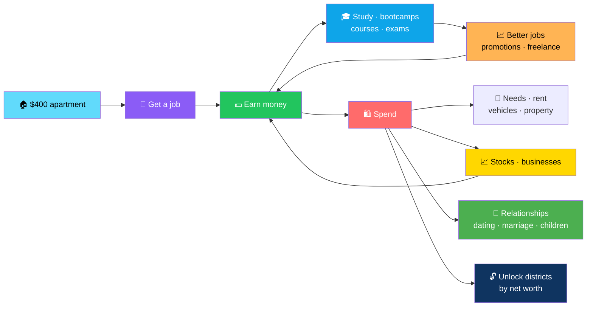
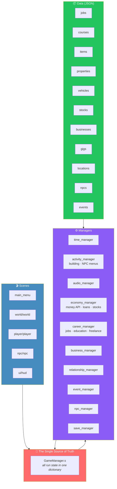
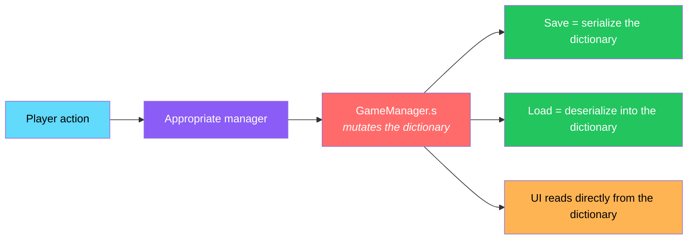
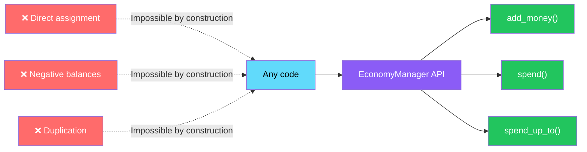

# 🌱 Life: New Beginnings

<div align="center">


**Start with ~$400 in a basic apartment. Build any life you like.**

*Jobs · Education · Relationships · Businesses · Properties · Stocks — a full life sim in Godot 4*

[🚀 Run](#-run) • [💡 Quick Start](#-quick-start-tips) • [✨ What's Implemented](#-what-is-implemented) • [🏗️ Architecture](#️-architecture) • [⚠️ Known Limitations](#-known-limitations-honest-list)

</div>

---

## 📖 Overview

**Life: New Beginnings** is a **2D top-down life-sim RPG** built in **Godot 4.3+ / GDScript**.

You start with about **$400** in a basic apartment — and build **any life you like**.

### Core Idea

> **One dictionary holds the entire world.**
>
> All run state lives in `GameManager.s`, so saving is just serializing it. Money only changes through `EconomyManager` — negative balances and duplication are **impossible by construction**.

### The Life Loop



---

## 🚀 Run

### 1. Install Godot

**Godot 4.3 or newer** — standard build, GDScript.

### 2. Import the Project

**Godot Project Manager → Import → select `project.godot` → open**

Let it import once.

### 3. Play

Press **F5** → **Main Menu** → **New Game** → create a character → **Begin Life**

---

## ⌨️ Controls

| Key | Action |
|-----|--------|
| **W A S D / Arrows** | Move |
| **E** | Interact (doors / people) |
| **P** | Phone |
| **M** | Map |
| **I** | Inventory |
| **V** | Switch vehicle |
| **Esc** | Pause |

**Time runs while you walk** — **1 real sec = 1 game minute**.

> 💡 **Speed controls:** 1× / 4× / 12× buttons in the HUD.
>
> **Menus pause time.**

---

## 💡 Quick-Start Tips

1. **Walk to the door of a building** — the glowing prompt appears at the bottom. Press **E**.
2. **Day 1:** buy groceries at **Corner Grocery**, then apply for a **Cashier** job *(also at Corner Grocery)* and work shifts **09:00–17:00**.
3. **Rent is due every 30 days.** Sleep at home. Eat. Watch **energy** and **hunger**.
4. **New districts unlock by net worth:**

| District | Net Worth Required |
|----------|:------------------:|
| **Commercial** | $500 |
| **Entertainment** | $1.5k |
| **Industrial** | $3k |
| **Financial** | $8k |
| **Suburbs** | $15k |

5. **Career paths:**
   - **Study at home** → **bootcamp at City University** → **Junior Developer**
   - **Freelance** from your home computer
   - **Save for a Coffee Shop** at Shop Unit A

---

## ✨ What Is Implemented

<div align="center">

| 🕐 Time & World | 👤 Character & Needs |
|:---:|:---:|
| Time · calendar · aging · day-night lighting · weather with rain particles | Needs · stats · **9 skills** · **6 backgrounds with perks** · character creator |
| **🏙️ The City** | **💼 Careers** |
| **8 districts** · **44 buildings** · locked-district barriers · opening hours | **39 jobs** · **11 career tracks** · requirements · shifts · tax · promotions · absence firing |
| **🎓 Education** | **💻 Freelance** |
| **10 courses** with exams | Freelance board with deadlines |
| **🛍️ Shops & Items** | **🏠 Property** |
| Shops · items · clothing · furniture | Rent · buy · sell properties |
| **🚗 Vehicles** | **🏦 Banking** |
| **7 vehicles** — speed · fuel · breakdowns | Savings · loans with interest · missed payments · repossession |
| **📈 Stocks** | **🏢 Businesses** |
| **6 stocks** with charts | **10 business types** with daily simulation — staff · stock · price elasticity · reputation · wages · rent — **keeps running off-screen** |
| **👥 NPCs & Relationships** | **🎁 Social Systems** |
| **12 NPCs** with schedules and needs · **5 relationship levels** → dating → official → living together → marriage → children | Gifts · memories |
| **🎲 Events & Endings** | **🏆 Achievements** |
| **19 random events** + **3 story beats** · **multiple endings** | **12 achievements** |
| **📱 Phone UI** | **🗺️ Map** |
| Stats · Jobs · Bank · Invest · People · Property · Map · Items · Log | Clickable fast-travel map |
| **💾 Save System** | **⚙️ Settings** |
| **4 save slots** + autosave · atomic writes · validation | Settings panel |
| **🔊 Audio** | |
| Procedural SFX · music hooks | |

</div>

### Detailed Feature List

#### 🕐 Time & World

- Time, calendar, aging
- Day-night lighting
- **Weather with rain particles**

#### 👤 Character & Needs

- **Needs** and **stats**
- **9 skills**
- **6 backgrounds with perks**
- Character creator *(placeholder art)*

#### 🏙️ The City

- **8 districts**
- **44 buildings**
- Locked-district barriers
- Opening hours

#### 💼 Careers

- **39 jobs** across **11 career tracks**
- Requirements, shifts, tax
- Promotions
- **Absence firing**

#### 🎓 Education

- **10 courses with exams**

#### 💻 Freelance

- Freelance board with deadlines

#### 🛍️ Shops & Items

- Shops, items, clothing, furniture

#### 🏠 Property

- Rent, buy, and sell properties

#### 🚗 Vehicles

- **7 vehicles** — speed, fuel, breakdowns

#### 🏦 Banking

- Savings
- **Loans with interest**
- **Missed payments**
- **Repossession**

#### 📈 Stocks

- **6 stocks with charts**

#### 🏢 Businesses

- **10 business types**
- **Daily simulation:**
  - Staff
  - Stock
  - Price elasticity
  - Reputation
  - Wages
  - Rent
- **Keeps running off-screen**

#### 👥 NPCs & Relationships

- **12 NPCs** with schedules and needs
- **5 relationship levels**
- Progression: **dating → official → living together → marriage → children**

#### 🎁 Social Systems

- Gifts
- Memories

#### 🎲 Events & Endings

- **19 random events**
- **3 story beats**
- **Multiple endings**

#### 🏆 Achievements

- **12 achievements**

#### 📱 Phone UI

- Stats
- Jobs
- Bank
- Invest
- People
- Property
- Map
- Items
- Log

#### 🗺️ Map

- **Clickable fast-travel map**

#### 💾 Save System

- **4 save slots** + autosave
- **Atomic writes**
- **Validation**

#### ⚙️ Settings

- Settings panel

#### 🔊 Audio

- Procedural SFX
- Music hooks

---

## 🏗️ Architecture

### System Overview



### Why the Single Dictionary Matters



> 💡 **Saving is serializing `GameManager.s`.**
>
> **Loading is deserializing into it.**
>
> **The UI reads directly from it.**
>
> No scattered state, no save/load bugs.

### Money Is a Sealed System



> 💡 **Money only changes through `EconomyManager.add_money / spend / spend_up_to`.**
>
> **Negative balances and duplication are impossible by construction.**

### 🗂️ Project Layout

```
life-new-beginnings/
├── data/        jobs, courses, items, properties, vehicles,
│                stocks, businesses, gigs, locations, npcs, events (JSON)
│
├── scenes/      main_menu, world/world, player/player, npc/npc, ui/hud
│
├── scripts/
│   ├── managers/     time_manager, game_manager (state, needs, achievements),
│   │                 activity_manager (all building/NPC menus), audio_manager
│   ├── economy/      economy_manager (money API, loans, stocks, monthly bills)
│   ├── careers/      career_manager (jobs, education, freelance)
│   ├── businesses/   business_manager
│   ├── relationships/relationship_manager
│   ├── events/       event_manager
│   ├── npc/          npc_manager, npc
│   ├── player/       player
│   ├── world/        world
│   ├── save/         save_manager
│   └── ui/           hud, phone, map_view, main_menu, save_panel,
│                     settings_panel, line_chart, char_draw, ui_util
│
├── tests/           test_runner.gd
└── assets/          sprites, animations, audio/music, audio/ambience, fonts
                     <em>empty: drop real assets here</em>
```

### Design Principles

<div align="center">

| Principle | Implementation |
|-----------|---------------|
| **🧠 One dictionary holds the world** | `GameManager.s` — save is serialize, load is deserialize, no scattered state |
| **💰 Money is sealed** | Only `EconomyManager` can change it — negative balances and duplication are impossible by construction |
| **📦 Content is data** | Jobs, courses, items, properties, vehicles, stocks, businesses, gigs, locations, NPCs, events — all JSON |
| **🎓 Progression is a real chain** | Education unlocks jobs, jobs unlock promotions, promotions unlock businesses |
| **🏢 Businesses keep running** | Off-screen simulation — staff, stock, price elasticity, reputation, wages, rent |
| **🌐 Offline-first** | One-time import, then the whole world lives in one project |
| **🚫 No fake features** | The **Known Limitations** section lists what isn't built |
| **🔧 Most content needs no code** | Add a job, a course, a business, an NPC, or an event by editing JSON |

</div>

---

## 📝 Add Content (No Code Needed for Most)

<div align="center">

| What to Add | Where |
|-------------|-------|
| **💼 Job** | Add an object to `data/jobs.json` — `workplace` = a building `type`; `promotes_to` chains the track |
| **🎓 Course / degree** | `data/courses.json` — `school` = `school` or `university`; its **id becomes a qualification** jobs can require via `education_any` |
| **🏢 Business type** | `data/businesses.json` |
| **🛍️ Item / shop stock** | `data/items.json` — `shop` = building type |
| **🏠 Building / district** | `data/locations.json` — buildings need a district + x,y inside the 1100×900 cell; add a `prop` for homes/units and a matching entry in `properties.json` |
| **👤 NPC** | `data/npcs.json` — home/work are building ids; schedule = `[hour, place]` |
| **🎲 Event** | `data/events.json` — conditions: `min_day`, `min_money`, `min_networth`, `has_job`, `has_vehicle`, `has_business`, `need_flag`, `need_npc`; effects: `money`, `stats`, `skills`, `rep`, `rel_npc`, `mood`, `flag`, `time` |
| **🎨 Real art** | Add an `AnimatedSprite2D` child *(animations `idle`, `walk`)* to `scenes/player/player.tscn` — the placeholder drawing switches off automatically |
| **🎵 Music / ambience** | Put `theme.ogg` in `assets/audio/music/` and `city.ogg` in `assets/audio/ambience/` |

</div>

---

## 🧪 Tests

```bash
godot --headless --path . -s tests/test_runner.gd
```

### What's Covered

<div align="center">

| Area | Coverage |
|------|:--------:|
| **Economy exploits** | ✅ |
| **Loans** | ✅ |
| **Stocks** | ✅ |
| **Time** | ✅ |
| **Jobs** | ✅ |
| **Business simulation** | ✅ |
| **Relationships** | ✅ |
| **NPC schedules** | ✅ |
| **Save / load** | ✅ |
| **Corrupted-save rejection** | ✅ |

</div>

### 📋 Manual UI Checklist

1. New game
2. Work a shift
3. Sleep
4. Save
5. Reload
6. Open each phone tab
7. Buy a vehicle
8. Start a business

---

## ⚠️ Known Limitations (Honest List)

> **These are what you should expect before your first run.**

<div align="center">

| Limitation | Details |
|-----------|---------|
| **Not yet run in-engine** | Written without running it in Godot — **expect a few first-run parse errors** to fix in the Godot editor *(check the Output/Debugger panel)* |
| **Placeholder art** | Drawn shapes |
| **NPC movement** | Walk in **straight lines** *(no pathfinding)* and **ignore building collisions** — they are hidden "inside" buildings |
| **No TileMapLayer yet** | The city is drawn from data (`world.gd`). Replace `_draw()` with TileMapLayers later — collisions/doors come from `locations.json` |
| **No traffic** | |
| **No building interiors** | |
| **No NPC-initiated meetings or phone texts** | |
| **No controller UI polish** | |
| **English only** | |
| **Music/ambience** | Need your own `.ogg` files |
| **Vehicle sounds** | Just a beep |
| **Balance is a first pass** | Tune numbers in `data/*.json` |

</div>

> 💡 **We'd rather list what isn't there than ship a fake button.**

---

## 🗺️ Roadmap

### ✅ Current

- [x] Time, calendar, aging
- [x] Day-night lighting
- [x] Weather with rain particles
- [x] Needs, stats, 9 skills
- [x] 6 backgrounds with perks
- [x] Character creator (placeholder art)
- [x] 8 districts, 44 buildings with locked-district barriers and opening hours
- [x] 39 jobs across 11 career tracks with requirements, shifts, tax, promotions, absence firing
- [x] 10 courses with exams
- [x] Freelance board with deadlines
- [x] Shops, items, clothing, furniture
- [x] Rent, buy, and sell properties
- [x] 7 vehicles with speed, fuel, and breakdowns
- [x] Bank: savings, loans with interest, missed payments, repossession
- [x] 6 stocks with charts
- [x] 10 business types with off-screen daily simulation
- [x] 12 NPCs with schedules and needs
- [x] 5 relationship levels through to children
- [x] Gifts and memories
- [x] 19 random events + 3 story beats, multiple endings
- [x] 12 achievements
- [x] Phone UI with 9 tabs
- [x] Clickable fast-travel map
- [x] 4 save slots, autosave, atomic writes, validation
- [x] Settings panel
- [x] Procedural SFX
- [x] Music hooks
- [x] Headless test runner covering economy, loans, stocks, time, jobs, business simulation, relationships, NPC schedules, save/load, and corrupted-save rejection

### 🔜 Future Ideas

- [ ] **TileMapLayer** — replace `_draw()` in `world.gd`
- [ ] **NPC pathfinding** — move around buildings instead of through them
- [ ] **Building interiors** — enterable spaces
- [ ] **Traffic** — moving vehicles
- [ ] **NPC-initiated meetings** — texts, calls, unplanned encounters
- [ ] **Controller support** — full gamepad UI
- [ ] **Localization** — languages beyond English
- [ ] **Real art pipeline** — sprite sheets, animations
- [ ] **Real audio** — music, ambience, vehicle sounds
- [ ] **Balance tuning** — numbers in `data/*.json`

---

## 🤝 Contributing

Contributions are welcome. Please:

1. Fork the repository
2. **Keep content in `data/*.json`** — most additions need no code
3. **Route money through `EconomyManager`** — never touch the balance directly
4. **Mutate only `GameManager.s`** — no scattered state
5. **Add tests for any new manager behavior** — the headless runner is the contract
6. **Report parse errors you fix** — the project hasn't been run in-engine yet
7. Submit a Pull Request

### Guidelines

- **Never break the save format** without a migration path
- **Never bypass `EconomyManager`** — money integrity is by construction
- **Never hard-code job, course, or building data** — it belongs in JSON
- **Never claim it has been play-tested** — the **Known Limitations** section is the standard
- **Never present a stub as a feature**

---

## 📜 License

MIT — see [LICENSE](LICENSE) for details.

---

## 🙏 Acknowledgments

- **Godot** — for a 2D engine that stays out of the way
- **Every life sim that ever made you late for work on purpose** — this one's for you

---

<div align="center">

### 🌱 START. WORK. LEARN. GROW.

**$400 and an apartment. Build any life you like.**

**One dictionary holds the world. Money is sealed. Content is data.**

<br>

> ⚠️ **Not yet run in-engine — expect a few first-run parse errors.**

<br>

⭐ If this project helped you, consider giving it a star.

<br>

[⬆ Back to Top](#-life-new-beginnings)

</div>
